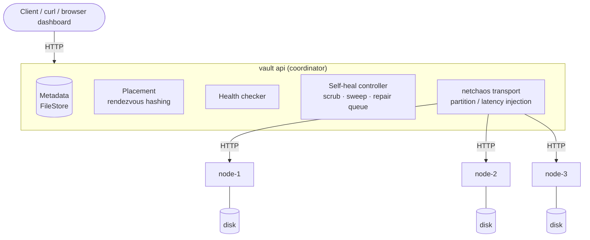
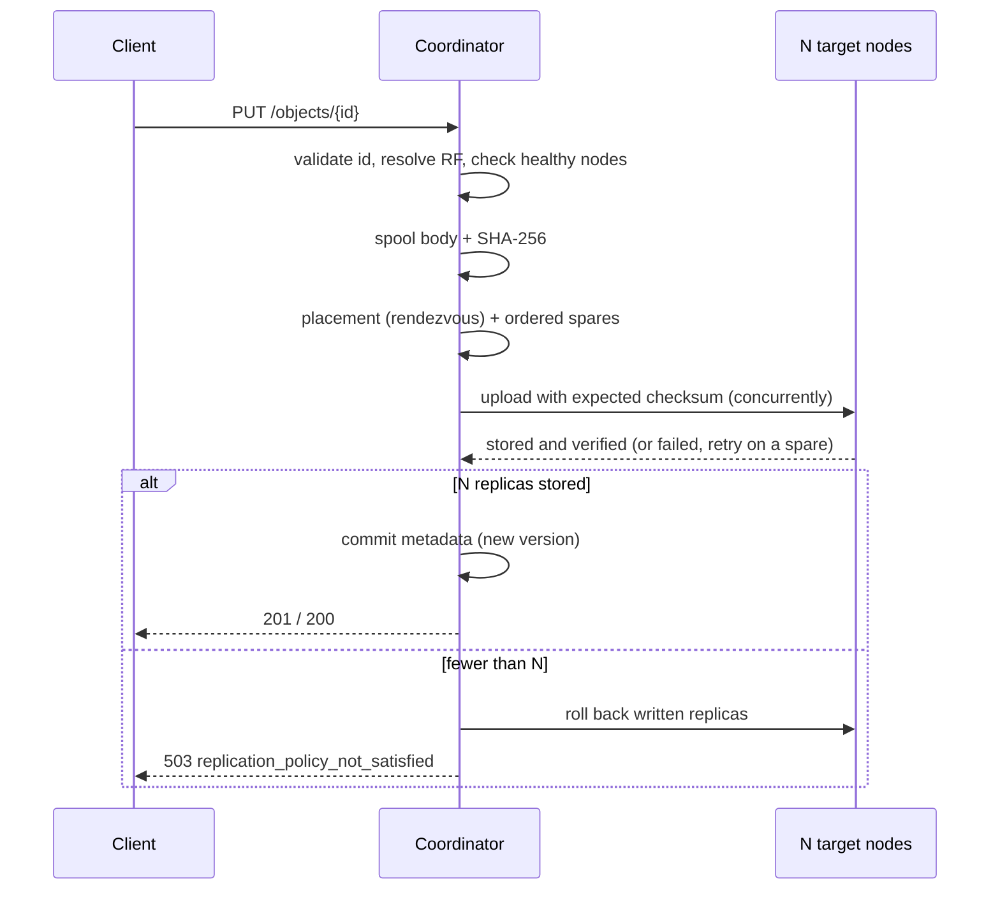
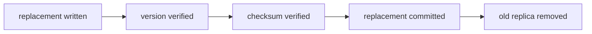

<div align="center">

# 🔐 Vault

**A self-healing distributed object store in Go that never serves bad bytes, even when nodes crash, lie about their data, or drop off the network.**

[](go.mod)
[](docker-compose.yml)
[](go.mod)

</div>

---

## 📖 Table of contents

- [What is it?](#-what-is-it)
- [Features](#-features)
- [Architecture](#-architecture)
- [Quick start](#-quick-start)
- [Concepts](#-concepts)
- [Object lifecycle](#-object-lifecycle)
- [API](#-api)
- [Self-healing (Phase 2)](#-self-healing-phase-2)
- [Versions and consistency (Phase 3)](#-versions-and-consistency-phase-3)
- [Resilience to network partitions (Phase 4)](#-resilience-to-network-partitions-phase-4)
- [Health and structured events](#-health-and-structured-events)
- [Running](#-running)
- [Testing](#-testing)
- [Project structure](#-project-structure)
- [Robustness basics](#-robustness-basics)
- [Current limitations](#-current-limitations)
- [Future stages](#-future-stages-not-implemented)

---

## 💡 What is it?

Imagine you save a photo, and Vault quietly keeps **three copies** of it on three different machines (called *storage nodes*). If one machine dies, you still get your photo from another one.

That part is common. What Vault adds:

- **It checks every byte.** Each copy has a fingerprint (a SHA-256 checksum). Every time you read a file, Vault checks the fingerprint. If a copy has silently gone bad on disk, Vault **refuses to give it to you** and uses a good copy instead.
- **It knows "alive" is not the same as "correct".** A machine can be running fine and still hold broken data. Vault treats these as two different problems.
- **It fixes itself.** A background job looks for broken or missing copies and makes new, verified ones, most urgent first.
- **It keeps versions straight.** Old data can never overwrite new data, and a deleted file can never come back from the dead.
- **It survives network splits.** If a machine is cut off and later comes back with old data, Vault cleans it up safely.

Vault was built in four phases:

| Phase | Goal | Highlights |
|---|---|---|
| **1** | Multi-process storage core | Replication, SHA-256 verification on every read, read failure tolerance, persistence |
| **2** | Self-healing | Background scrubber, HEALTHY / DEGRADED / CRITICAL / LOST classification, blast radius, risk-prioritised repair on bounded workers, metrics and an event timeline |
| **3** | Consistent versions | Monotonic versions, durable tombstones, compare-and-swap (`expected_version`), `CURRENT` / `STALE` / `CORRUPTED` / `MISSING` / `UNAVAILABLE` replica states, `GET /objects/{id}/consistency` |
| **4** | Network partitions | Partition and latency injection, write/read quorums (`W`, `R`), reconciliation on recovery, one guarded replica-removal path, measured storage metrics |

> [!NOTE]
> The [Current limitations](#-current-limitations) section lists what is **not** built. Please read it before using Vault for anything real. There is no auth and no TLS.

---

## ✨ Features

- 🧩 **Real multi-process cluster.** One coordinator plus N storage nodes, each a separate OS process with its own data directory.
- 🔁 **Replication with all-or-nothing writes.** Rendezvous-hashing placement, spare-node retry, rollback on failure. The policy is never silently downgraded.
- 🛡️ **End-to-end integrity.** SHA-256 checked on write (by the node) and on every read (by the coordinator). Corrupt bytes are never returned.
- 🩺 **Background scrubber.** Nodes re-hash their own files, so no object bytes cross the network, and the coordinator compares the result with metadata.
- 🚑 **Self-healing repair queue.** CRITICAL before DEGRADED, bounded workers, deduplication, exponential backoff, and verified source to verified target copies.
- 💥 **Blast radius.** See what losing any node would do, computed from metadata.
- 🧾 **Monotonic versions and tombstones.** Deleted objects can't come back, and stale replicas are never authoritative.
- 🔒 **Compare-and-swap.** `?expected_version=N` on PUT and DELETE, so concurrent clients never lose updates.
- 🌐 **Partition-aware.** Tells **node failure**, **network partition** and **corrupted data** apart.
- ⚖️ **Configurable quorums.** `W` and `R` can be `all`, `majority`, `one` or a number, set per cluster or per request.
- 🧹 **Reconciliation and guarded removal.** A returning node is cleaned up with strict ordering, and the last valid copy is never deleted.
- 📊 **Measured storage metrics.** Logical and physical bytes, overhead and repair bytes. They say "unknown" (`null`) instead of guessing.
- 🧪 **Chaos endpoints.** Kill nodes, corrupt replicas, cut links and add latency for real (opt-in with `--enable-chaos`).
- 🖥️ **Browser dashboard.** Served at `/` by the API. It is one static page that drives the same JSON endpoints as `curl` and the tests.
- 🐳 **Docker Compose deployments** with 3 or 5 nodes, plus smoke-test scripts.
- 📦 **Standard library only.** `go.mod` has no external dependencies.

---

## 🏗️ Architecture



- Each **node** is a separate OS process with a separate data directory.
- All traffic is **coordinator ↔ node**. There is no node-to-node traffic.
- Every coordinator request to a node (probes, reads, writes, verifies, deletes, repair copies) goes through the `netchaos` HTTP transport. Faults are only injected there when chaos is enabled.

---

## 🚀 Quick start

**Requirements:** Go ≥ 1.23 (from `go.mod`). Docker is optional.

```sh
make demo              # Phase 1: corrupt a replica, watch reads reject it (self-healing off)
make demo-selfheal     # Phase 2: 5 nodes, kill 2, blast radius, CRITICAL-first repair
make demo-corruption   # Phase 2: silent corruption on a live node -> scrub -> verified repair
make demo-all          # all three demos in a row

make cluster           # api :8080 + nodes :9001-9003, auto-repair + chaos on (Ctrl-C to stop)
```

Then, in another terminal:

```sh
curl -X PUT --data-binary @photo.jpg localhost:8080/objects/photo.jpg
curl -o out.jpg -D - localhost:8080/objects/photo.jpg
curl localhost:8080/objects/photo.jpg/metadata
ls ./data/node-*/objects/photo.jpg/      # the bytes, in three separate node directories
```

Open <http://localhost:8080/> to see the dashboard.

**Docker:**

```sh
make docker-up && make docker-smoke                     # 3 nodes
make docker-selfheal-up && make docker-selfheal-smoke   # 5 nodes, self-healing
make docker-partition-up && make docker-partition-smoke # Phase 4: partition -> quorum -> healing (5 nodes, fresh volumes)
```

**Tests:**

```sh
make test         # go vet + unit + multi-process integration tests
make test-race    # the same with the race detector (also in the spawned processes)
```

<details>
<summary>All Makefile targets</summary>

| Target | What it runs |
|---|---|
| `build` | `go build -o bin/vault ./cmd/vault` |
| `test` | `go vet ./...` then `go test -count=1 ./...` |
| `test-unit` | `go test ./internal/...` |
| `test-integration` | `go test -count=1 ./test/integration/` |
| `test-race` | `go test -race -count=1 ./...` |
| `demo` / `demo-selfheal` / `demo-corruption` / `demo-all` | `./bin/vault demo [self-heal \| corruption-repair \| all]` |
| `cluster` | `./bin/vault cluster --data ./data` |
| `docker-up` / `docker-smoke` / `docker-down` | 3-node Compose stack |
| `docker-selfheal-up` / `docker-selfheal-smoke` / `docker-selfheal-down` | 5-node Compose stack |
| `docker-partition-up` / `docker-partition-smoke` | 5-node stack from fresh volumes + Phase 4 smoke test |
| `clean` | `rm -rf bin data` |

</details>

---

## 🧠 Concepts

### Storage node (`vault node`)

A storage node is one `vault node` process. Each node has:

- a unique **node ID** (`--id node-2`);
- its own **HTTP server** (`--listen 127.0.0.1:9002`);
- its own **data directory** (`--data ./data/node-2`). It claims the directory on first start by writing `node.json`, and refuses to open a directory that belongs to a different node ID.

What a node does:

- **Persist bytes.** Writes go to `tmp/`, are fsynced, then atomically renamed into `objects/<id>/<version>.data`. A sidecar `<version>.json` records the SHA-256 and size.
- **Verify on write.** The coordinator sends the expected SHA-256 and length with each upload. The node hashes the bytes as they arrive and refuses to commit them on a mismatch (HTTP 422).
- **Serve bytes as-is.** A node's `GET` does not vouch for the bytes. The coordinator verifies them.
- **Re-verify on demand.** `GET /replicas/{id}/{v}/verify` re-hashes the file on disk and compares it with the recorded checksum.
- **Report health and capacity.** `GET /health` returns node ID, status, filesystem total/free, and replica bytes/count.
- **Survive restarts.** Nothing is kept only in RAM. Usage counters are rebuilt from disk on start, and leftover temp files from interrupted writes are removed.

### Coordinator (`vault api`)

The coordinator handles client requests, object metadata, replica selection, replication, read coordination and integrity-aware replica selection. It stores no object bytes, only short-lived spool files.

---

## 🔄 Object lifecycle

### ✍️ Write: `PUT /objects/{id}`



1. The object ID is validated: `[A-Za-z0-9][A-Za-z0-9._-]{0,199}`. No path separators and no leading dot, so no path traversal.
2. The replication factor (RF) comes from `?replication_factor=N` or the configured default. If N is < 1 or larger than the cluster, the request gets **400**.
3. If fewer than N nodes are healthy, the request gets **503 `insufficient_healthy_nodes`** before the body is read.
4. The body is streamed to a spool file while being hashed (SHA-256 + size), up to `--max-object-size`.
5. **Placement:** rendezvous hashing over the healthy nodes picks N distinct targets. The other healthy nodes are kept as ordered spares.
6. The bytes go to all N targets at the same time, each with the expected checksum. If a target fails, that slot is retried on the next unused spare.
7. **All or nothing.** If fewer than N replicas are stored, every replica that was written is deleted again (rollback). The client gets **503 `replication_policy_not_satisfied`** with per-node attempts. The previous version of the object, if any, is untouched. The policy is never silently downgraded.
8. Only after N replicas are confirmed is the metadata committed with a new version. The client gets **201** (new) or **200** (overwrite).
9. On an overwrite, the previous version's replicas are deleted. Any node where that fails is listed in `retained_stale_replicas`.

Writes to the **same** object are serialised by a per-object lock. Writes to **different** objects run in parallel.

### 📥 Read: `GET /objects/{id}`

1. Look up the metadata: expected SHA-256, size and replica list.
2. Order the candidates. The `?prefer=node-X` replica goes first, then HEALTHY replicas, then replicas believed UNAVAILABLE as a last resort (health information can be stale).
3. For each candidate, stream the replica into a spool file while hashing it, reading at most `size + 1` bytes.
4. Compare with the expected digest:
   - **match:** `CHECKSUM_VERIFIED`, and this replica serves the read;
   - **mismatch:** `CHECKSUM_MISMATCH` (WARN). The replica is **rejected**, the failure is recorded in the object's metadata (`integrity_failures`), and the next replica is tried;
   - **node unreachable:** the node is marked UNAVAILABLE immediately and the next replica is tried;
   - **replica missing** on a live node: recorded as `replica_missing`, and the next replica is tried.
5. Only fully verified bytes are sent to the client. Response headers show what happened:

```
X-Vault-Served-By: node-3
X-Vault-Rejected-Replicas: node-2=checksum_mismatch
X-Vault-Sha256: b53d2e2c…
X-Vault-Version: 1
```

If no replica verifies, the client gets **503 `no_verified_replica`** with every attempt. **Corrupt bytes are never returned.**

> [!IMPORTANT]
> A node being alive does not mean its data can be trusted. The health checker only answers "is the process responding?". Integrity is decided per read, per replica, by checksum.

### 🗑️ Delete: `DELETE /objects/{id}`

Delete first writes a durable **tombstone** at version `current+1`, before any node is touched. From that moment the object reads as 404. The coordinator then asks every replica node to delete all stored versions. It holds the object lock, so no newer write can be landing on those nodes.

The response lists `deleted`, `already_absent` and `unreachable` nodes, plus `tombstone_version` and `fully_purged`. `fully_purged` is `false` if a node could not be reached. That node's leftover bytes can never be served or bring the object back, and they are purged when the node is reachable again (see [Phase 3](#-versions-and-consistency-phase-3)).

---

## 🔌 API

Errors always use one envelope:

```json
{"error": {"code": "...", "message": "...", "details": {...}}}
```

### Objects

| Method | Path | Result |
|---|---|---|
| `PUT` | `/objects/{id}[?replication_factor=N]` | 201/200 + metadata, replication `{required, achieved, status}`, per-node attempts. 400 bad id/RF · 413 too large · 503 insufficient nodes / policy not met |
| `GET` | `/objects/{id}[?prefer=node-X]` | 200 verified bytes (streamed) · 404 · 400 bad preference · 503 no verified replica |
| `HEAD` | `/objects/{id}` | 200 with `Content-Length`, `ETag` (sha256), `X-Vault-*` headers · 404 |
| `DELETE` | `/objects/{id}` | 200 + per-node result · 404 |
| `GET` | `/objects` | list all object metadata |
| `GET` | `/objects/{id}/metadata` | 200 metadata JSON (including `integrity_failures`) · 404 |
| `GET` | `/objects/{id}/consistency[?verify=false]` | Phase 3: latest record (live/deleted), every node's held versions and replica state |
| `PUT`/`DELETE` | `/objects/{id}?expected_version=N` | Phase 3: compare-and-swap; mismatch → 409 `write_conflict` |
| `PUT`/`GET` | `/objects/{id}?write_quorum=W` · `?read_quorum=R` | Phase 4: per-request quorum (`all`, `majority`, `one` or N); below quorum → 503 `quorum_not_met` |

### Cluster, health and self-healing

| Method | Path | Result |
|---|---|---|
| `GET` | `/` | browser dashboard (static page that calls the JSON endpoints) |
| `GET` | `/health` | API liveness + healthy node count |
| `GET` | `/nodes` | every node's `HEALTHY`/`UNAVAILABLE` state, last check, last error, capacity |
| `GET` | `/objects/{id}/health` | object state, per-replica state (node vs replica), reason, queue/last repair |
| `POST` | `/objects/{id}/repair` | assess + enqueue (deduplicated) |
| `GET` | `/cluster/status` | nodes (+ tracked replicas), object counts by state, at-risk objects, repair/scrub summary, failure impacts |
| `GET` | `/nodes/{id}/blast-radius` | impact of losing that node, from metadata |
| `POST` | `/scrub/run` | run a scrub pass now and return its report |
| `GET` | `/repair/queue` | active, queued (in execution order, with priority + reason), parked-failed |
| `GET` | `/repair/metrics` · `/repair/history` | metrics; per-attempt timeline |
| `POST` | `/repair/pause` · `/repair/resume` · `/repair/sweep` | hold/release repairs; re-assess everything now |
| `GET` | `/events?event=&since=&limit=` | recent structured events |

### Resilience (Phase 4)

| Method | Path | Result |
|---|---|---|
| `GET` | `/cluster/diagnosis` | per node `HEALTHY` / `SLOW_LINK` / `NETWORK_PARTITION` / `NODE_UNREACHABLE` / `CORRUPTED_DATA` |
| `POST` | `/nodes/{id}/reconcile` · `/reconcile` | reconcile one / every reachable node now |
| `GET` | `/storage/metrics` | logical/physical bytes, replica counts, overhead, breakdown, repair bytes, guarded removals |

### Chaos (requires `--enable-chaos`)

| Method | Path | Result |
|---|---|---|
| `POST` | `/chaos/kill-node/{nodeId}` | really terminates the node process |
| `POST` | `/chaos/corrupt-replica/{objectId}/{nodeId}` | really flips 16 bytes of the replica file on that node's disk |
| `POST` | `/chaos/partition/{nodeId}[?duration=10s]` | cut the coordinator→node link now (optionally healing by itself) |
| `POST` | `/chaos/partition/{nodeId}?trigger=upload\|download\|ack&after_bytes=N&method=PUT` | cut the link mid-transfer |
| `POST` | `/chaos/latency/{nodeId}?ms=N` | add link latency |
| `POST` | `/chaos/heal/{nodeId}` · `/chaos/heal` | heal one link / all links (and clear latency) |
| `GET` | `/chaos/network` | current link faults |

### Node-internal API (used by the coordinator)

`GET /health` · `GET /replicas` (inventory) · `GET /replicas/{id}` · `PUT|GET|DELETE /replicas/{id}/{version}` · `DELETE /replicas/{id}` · `GET /replicas/{id}/{version}/verify` · chaos-only: `POST /admin/terminate`, `POST /admin/corrupt/{id}/{version}`.

### Metadata model

```json
{
  "id": "dataset.bin",
  "version": 1,
  "size": 1048576,
  "sha256": "b53d2e2c…",
  "created_at": "…", "updated_at": "…",
  "replication_factor": 3,
  "replicas": ["node-2", "node-3", "node-1"],
  "integrity_failures": [
    {"node_id": "node-2", "version": 1, "reason": "checksum_mismatch",
     "expected_sha256": "b53d…", "observed_sha256": "a562…",
     "first_detected_at": "…", "last_detected_at": "…", "occurrences": 1}
  ]
}
```

Metadata sits behind the `metadata.Store` interface (`GetObject`, `PutObject`, `UpdateObject`, `DeleteObject`, `ListObjects`, `RecordIntegrityFailure`). The current implementation, `FileStore`, writes one JSON file per object with fsync + atomic rename, so writes to different objects don't contend.

> [!WARNING]
> Metadata is **durable across API restarts but local to one API process. It is not replicated and not consensus-backed.**

---

## 🚑 Self-healing (Phase 2)

### Three kinds of state

Process health and data integrity are tracked separately. A node's process can be answering (node `HEALTHY`) while one of its replicas is `CORRUPTED`.

| Level | States | Source of truth |
|---|---|---|
| Node | `HEALTHY`, `UNAVAILABLE` | health checker (probes + failed requests) |
| Replica | `CURRENT`, `STALE`, `CORRUPTED`, `MISSING`, `UNAVAILABLE` | metadata `integrity_failures` for the current version, plus the node state (Phase 3 renamed replica `HEALTHY` → `CURRENT` and added `STALE`) |
| Object | `HEALTHY` (≥ RF verified replicas), `DEGRADED` (2 … RF-1), `CRITICAL` (exactly 1), `LOST` (0) | computed live by `durability.Assess` |

A replica is CURRENT when its node is up and no read, scrub or repair has found its bytes wrong. Every replica was verified by its node when written. `GET /objects/{id}/health` shows the per-replica breakdown and a reason, for example: `Only 1 verified replica remains for RF=3 (node-2 UNAVAILABLE, node-4 UNAVAILABLE).`

### 🔍 Scrubber

Each scrub pass walks every replica of every object's current version, with bounded concurrency (`--scrub-concurrency`, env `VAULT_SCRUB_CONCURRENCY`, default 4).

- The node re-hashes its own file (`GET /replicas/{id}/{v}/verify`). **No object bytes cross the network.**
- The coordinator compares the node's digest with the SHA-256 and size **in metadata**, never with the node's own record.
- A mismatch or missing file is recorded as an integrity failure, so the replica becomes CORRUPTED/MISSING. The pass emits `SCRUB_CORRUPTION_DETECTED`/`SCRUB_REPLICA_MISSING` and triggers repair.
- A replica that verifies cleanly has any old failure record cleared.
- Replicas on unavailable nodes are skipped, not reported as corrupt.

Scrubs run every `--scrub-interval` (env `VAULT_SCRUB_INTERVAL`, default 1m; 0 disables) and on demand with `POST /scrub/run`. Passes never overlap. Corruption found by an ordinary client read also triggers repair right away.

### Detection → queue

The self-heal controller re-assesses every object:

- on every node state change (it also computes and logs the failed node's blast radius);
- on every recorded integrity failure;
- after every repair;
- every `--sweep-interval` (default 5s), as a safety net.

It emits `OBJECT_DEGRADED` / `OBJECT_CRITICAL` / `OBJECT_LOST` / `OBJECT_RESTORED` on transitions and queues DEGRADED and CRITICAL objects. LOST objects have no verified source, so they are reported, not queued.

### Risk-prioritised repair queue

Order (see `repair.less`):

1. state: CRITICAL before DEGRADED;
2. fewer verified replicas first (matters for RF > 3);
3. oldest queue time;
4. object ID.

A queued object whose state gets worse (for example, a second node fails) is re-prioritised in place. Every entry carries `priority` and `reason`. `GET /repair/queue` returns the queue in the exact order workers will take it.

### Workers, dedupe, retries

- **Bounded workers:** exactly `--repair-workers` (env `VAULT_REPAIR_WORKERS`, default 4). There is never one goroutine per object.
- **At most one queue entry and one active repair per object.** Duplicate requests (sweeps, `POST /objects/{id}/repair`, integrity hooks) are merged and counted in `deduplicated_total`. The coordinator also has its own per-object repair guard.
- **Idempotent:** repairing an object that already meets policy does nothing.
- **Bounded retry:** a failed or partial attempt retries with exponential backoff (`--repair-backoff` 500ms, doubling up to `--repair-max-backoff` 30s). After `--repair-max-attempts` (default 5) the task is **parked as failed**, and the object honestly stays DEGRADED/CRITICAL. Parked tasks are released when the cluster topology changes (a node fails or recovers).
- `POST /repair/pause` / `POST /repair/resume` hold and release new repairs. Running repairs finish. The demos use this to show the queue before it drains.

### Repair lifecycle

`coordinator.RepairObject` runs these steps:

1. Take the object's repair guard. A concurrent repair of the same object gets `ErrInProgress`.
2. Assess the current version. If it already meets RF, stop (no-op). If there are 0 verified replicas, stop with `no verified source`.
3. **Pick targets:** healthy nodes that don't hold a healthy replica, in rendezvous order. Fresh nodes come first. An in-place rewrite over a corrupted replica on a live node is used only when no fresh node exists. No targets means `repair unavailable: no eligible healthy target node`, and the object stays below policy.
4. **Verified source:** stream a candidate replica into a spool while hashing, and compare with metadata. A candidate that fails (corruption nobody had noticed yet) is recorded as CORRUPTED, skipped and never used (`REPAIR_SOURCE_REJECTED`).
5. **Write** to each target. The node verifies the declared SHA-256 while receiving and refuses mismatched bytes. The coordinator then asks the target to **re-hash the replica from disk** (`REPAIR_CHECKSUM_VERIFIED`). If a target fails, the repair tries the next eligible one (`REPAIR_TARGET_FAILED`).
6. **Commit** under the object's write lock, the same lock PUT and DELETE take. Metadata is re-read, and the commit happens only if **version and checksum are still current**. Each verified target replaces one unhealthy entry (corrupted/missing first, then unavailable). Metadata never names a replica before its bytes are written and verified.
7. If the object changed (new version or deleted) during the copy, nothing is committed, the copied files are deleted, and the task is dropped as superseded. **Stale bytes can never be installed**, because replicas are stored per version and the commit is guarded by version.
8. Corrupted bytes on live nodes that were replaced are deleted.

Partial progress (for example 1 of 2 needed copies) is committed and reported as `partial`, and the task retries.

### 💥 Blast radius

`GET /nodes/{id}/blast-radius` shows the impact of losing that node. It is computed from metadata, with that node treated as unavailable and all other nodes in their current state. It lists affected objects/bytes, how many are still protected, degraded, critical or lost, and the per-object states, most severe first. The controller also computes it the moment a node goes down and logs `BLAST_RADIUS_CALCULATED`. `GET /cluster/status` includes the latest one per failed node.

### 📈 Metrics and timeline

`GET /repair/metrics` returns counters and live gauges, all from real operations:

- **counters:** queued, deduplicated, started, repaired, partial, failed, retries, not-needed, superseded, replicas created, bytes transferred;
- **gauges:** queue depth, repairing, parked, paused;
- **timings:** repair duration (min/avg/max/last) and **recovery time**, from when the object was first seen below policy to when a repair restored it;
- object counts by state.

`GET /repair/history` gives a per-attempt timeline: detected, queued, started, completed, source, targets, bytes, before/after replica counts, outcome, error. `GET /events` exposes the last 5,000 structured events (`?event=NAME`, `?since=SEQ`). The JSON log on stderr remains the full record.

### 🧪 Chaos endpoints

These are **off by default**. They need `--enable-chaos` on the API **and** on each node. `vault cluster`, the demos, the tests and the Docker demo deployment turn them on.

| Endpoint | What really happens |
|---|---|
| `POST /chaos/kill-node/{nodeId}` | Calls the node's `POST /admin/terminate`. The node **process exits** (`os.Exit` after the response is flushed, like a crash). The coordinator then probes until the node stops answering and reports it unavailable. The coordinator doesn't own node processes (in Docker they're separate containers), so this is the cleanest real mechanism. A killed node is brought back by its supervisor (`vault cluster` launcher, `docker compose start vault-node-N`). |
| `POST /chaos/corrupt-replica/{objectId}/{nodeId}` | Calls the node's `POST /admin/corrupt/{id}/{v}`. The node **flips 16 bytes of the replica file on its disk**, leaving its checksum record, its process and the coordinator's metadata untouched. Detection is left to Vault's own scrub and reads. |

There is no second implementation for the UI. The endpoints, the dashboard, the CLI demos and the tests all call the same coordinator and controller methods.

---

## 🧾 Versions and consistency (Phase 3)

### Monotonic versions and tombstones

Every successful PUT creates exactly the next version: the latest record's version + 1. The latest record may be a live object *or a tombstone*, so versions never restart. Example: v1 → v2 → DELETE writes tombstone v3 → PUT creates v4.

- Tombstones are ordinary metadata records (`deleted: true`, `deleted_at`). They are fsynced like everything else and survive restarts.
- Live reads (`GET`, `HEAD`, `/metadata`, `/health`, listings, sweeps, repair, scrub verification) treat a tombstone as not found.
- `GET /objects/{id}/consistency` shows it as `state: deleted`.
- `created_at` restarts when an object is re-created after a delete.
- `VERSION_CREATED` and `TOMBSTONE_CREATED` record each step.

Each replica knows its version: files are `objects/<id>/<version>.data`, with a record naming the object ID and version. A node refuses to serve a file whose record names a different version.

### 🔒 Compare-and-swap (`expected_version`)

`PUT` and `DELETE` accept `?expected_version=N` (or the `X-Vault-Expected-Version` header).

| `expected_version` | Proceeds when |
|---|---|
| `N > 0` | the current **live** version is exactly N |
| `0` | there is no live object (absent or deleted): create-only |
| omitted | always (unconditional; each write still gets its own version) |

A mismatch returns **409 `write_conflict`** with `expected_version`, `current_version`, `current_state` (`live`/`deleted`/`absent`) and `tombstone_version`, and emits `WRITE_CONFLICT`.

The real check runs under the same per-object lock that serialises PUT, DELETE and repair commits, and **before any replica is written**. So a failed CAS leaves no metadata change and no replica bytes, and concurrent read-modify-write clients using CAS never lose an update. Repairs don't change the version, so they never break a client's CAS.

### Stale replicas

A replica is **STALE** when its node holds only an older version than the current one. Two cases:

- a *listed* replica whose node lost the current version but kept an older one (for example, its disk was restored from an old snapshot);
- a *leftover* on a node that was down during an overwrite or delete and came back with old bytes.

The rules:

- **Stale replicas are never authoritative.** Reads fetch only the current version from listed replicas. A leftover node isn't listed at all, so `?prefer=` it is rejected.
- **Older data never overwrites newer data.** A node refuses (`409 stale_version`) any write of a version older than the newest it holds. Rewriting the same version is allowed; that is how in-place repair works.
- **Repair installs only the current version.** The Phase 2 commit guard is unchanged: version and checksum are re-checked under the object lock, and a newer write or a delete supersedes the repair.
- **Detection:** when the scrubber finds a listed replica missing its current version, it checks what the node holds. If an older version is there, it records `STALE` (`STALE_REPLICA_DETECTED`), and repair rewrites or replaces it (`STALE_REPLICA_REPAIRED`, action `rewritten`/`replaced`).
- **Purge:** every scrub pass then compares each reachable node's inventory (`GET /replicas` on the node) with all metadata records, live and tombstones. It deletes every stored version *older than the latest record* (`STALE_REPLICA_REPAIRED`, action `purged`). This is how pre-tombstone data on a returning node is removed. Versions equal to or newer than the record are never touched, because they may belong to an in-flight write or repair.

### Consistency endpoint

`GET /objects/{id}/consistency[?verify=false]` returns:

- the latest record: `state` live/deleted, `current_version`, sha256, size, RF, durability;
- for **every node that is listed or actually holds bytes**: `versions_held` (from the node's own inventory), `state` (`CURRENT`/`STALE`/`CORRUPTED`/`MISSING`/`UNAVAILABLE`, plus `UNCOMMITTED` for bytes newer than any record), `listed`, `authoritative`, and a detail. By default, listed current replicas are re-hashed by their nodes;
- `unchecked_nodes`: unreachable nodes that aren't listed but might hold leftovers;
- `consistent`: for a live object, exactly RF authoritative replicas and nothing stale or uncommitted anywhere; for a deleted object, no node holds any bytes.

### Crash safety of repair

A repair writes and verifies its copies, *then* commits metadata. If the coordinator dies in between, the durable metadata is unchanged. The uncommitted copy is not listed, so it is not authoritative (consistency shows it as a non-listed copy), and the object stays DEGRADED until a repair commits properly. `--test-repair-commit-delay` is a fault-injection flag that makes this window deterministic for tests.

---

## 🌐 Resilience to network partitions (Phase 4)

### Network partitions (chaos)

Faults are injected in the coordinator's HTTP transport, **below** the node client (`internal/netchaos`). Every request the coordinator makes to a node goes through it: health probes, replica reads and writes, verifications, deletes and repair copies. Nothing above the transport knows the fault is simulated. A partitioned node looks exactly like any node the real code cannot reach, and gets no special treatment.

- **Partition:** `POST /chaos/partition/node-3` cuts the link. New requests fail like a dead route, and in-flight transfers break. `?duration=10s` makes it temporary: it heals by itself.
- **Mid-transfer partition:** `?trigger=upload|download|ack&after_bytes=N&method=PUT|GET` arms a cut during the next replica transfer:
  - after N bytes of an upload;
  - after N bytes of a download;
  - or after the node has *handled* the request but before its answer arrives (`ack`: the write landed, but the acknowledgement was lost).

  This makes "partition during write" and "partition during read" deterministic.
- **Latency:** `POST /chaos/latency/node-2?ms=300` delays every request on the link. Latency above the probe timeout (800 ms) makes the node look unreachable, just like a real slow link would.
- **Heal:** `POST /chaos/heal/{node}` or `POST /chaos/heal`.

Vault has no node-to-node traffic: every link is coordinator↔node, so a partition is the set of nodes cut off from the coordinator. The node process is untouched. It keeps running and answers anyone else, e.g. `docker compose exec vault-node-3 wget -qO- localhost:9001/health`. Injection exists only with `--enable-chaos`.

**Node failure ≠ network partition ≠ corrupted data.** `GET /cluster/diagnosis` classifies every node:

| Diagnosis | Meaning |
|---|---|
| `NETWORK_PARTITION` | the coordinator→node link is cut (injected). The process runs and keeps its data, which may be stale when the link heals |
| `NODE_UNREACHABLE` | the node does not answer and no partition was injected: process or host down, or a real network fault that the coordinator cannot tell apart from one |
| `CORRUPTED_DATA` | the node answers, but replicas on it failed checksum verification |
| `SLOW_LINK` / `HEALTHY` | reachable, with or without injected latency |

For safety, the consistency logic treats a partitioned node and a dead node the same way: both are unreachable. The difference shows when the node comes back with its old bytes, which is what reconciliation is for.

### ⚖️ Quorum

`--write-quorum` (default `all`) and `--read-quorum` (default `1`) accept `all`, `majority`, `one` or a count. A single request can override them with `?write_quorum=` / `?read_quorum=`. The defaults keep the Phase 1–3 behaviour.

- **Write, W < RF:** the write goes to up to RF healthy nodes. It is acknowledged once **W replicas have stored and verified it**: each node hashes the bytes as it stores them, and its committed record must name the right version and checksum. It is committed with the replicas that actually hold it. With fewer than RF, the object is DEGRADED and the existing repair restores RF. Below W, every written replica is rolled back, nothing is committed, and the client gets **503 `quorum_not_met`**. Fewer healthy nodes than W fails before the body is read.
- **Write, W = RF (default):** unchanged Phase 1–3 behaviour and errors (`insufficient_healthy_nodes`, `replication_policy_not_satisfied`).
- **Read, R > 1:** one replica is read and verified end to end. The other listed replicas re-hash their copies on their own disks, so no bytes move. Bytes are returned only if **R replicas hold the current version with the metadata checksum**; otherwise **503 `quorum_not_met`** and no bytes. Response headers: `X-Vault-Read-Quorum`, `X-Vault-Confirmed-By`.
- **Phase 3 rules still decide:** metadata, never a node, names the current version. A stale or partitioned replica can neither serve a read nor count toward a quorum. Stale copies are also recorded `STALE`. A tombstoned object is 404.

### Healing and reconciliation

When a node this coordinator saw as UNAVAILABLE is reachable again (a healed partition or a restarted node), the controller **reconciles it before releasing queued repairs**. This is controlled by `--reconcile-on-recovery` (default on). `POST /nodes/{id}/reconcile` and `POST /reconcile` run it on demand.

For every object the node holds or is listed for, reconciliation takes the object lock and the object's repair guard, so no write, delete or repair of that object is in flight. It then checks against the latest record:

| Node holds | Action |
|---|---|
| anything of a **tombstoned** object | removed. The data can never bring the object back |
| its **listed** replica | re-verified like a scrub. A wrong checksum, a missing file or an older version is recorded `CORRUPTED`/`MISSING`/`STALE`, which queues the existing repair |
| an **unlisted verified copy of the current version** | **adopted** into the replica set if the object is below RF, restoring RF with no data transfer. Otherwise removed as an extra copy, once RF verified copies exist elsewhere |
| an unlisted copy that fails verification, an **older** (stale) or **newer** (uncommitted, from a failed write whose rollback could not reach it) version | removed through the guarded path |
| bytes of an ID with **no record** | kept and reported (never acknowledged, but never guessed about) |

Then the sweep queues repair for anything below RF. The newest valid version always wins, because it is the only one metadata names. Every result shows up in `RECONCILE_*` / `REPLICA_*` events, in `last_reconcile` in `/cluster/status`, and in `/storage/metrics`.

### 🧹 Guarded replica removal

`removeReplicaLocked` (`internal/coordinator/safe_remove.go`) is the single path by which Vault destroys a replica that could still be a valid copy. Repair (replaced replicas), reconciliation, scrub's stale-version purge and post-overwrite cleanup all go through it. The order is fixed:



- A **listed** replica of the current version is never removed directly. A verified replacement must be committed first, after which the old one is no longer listed.
- An **extra** valid copy needs RF verified copies on other nodes.
- **Stale, uncommitted or invalid** bytes need one verified copy of the current version on another node. So the last physical remnant of an object whose current version cannot be verified is **kept** (`REPLICA_REMOVAL_REFUSED`).
- **Deleted-object** data needs none. The tombstone is re-read under the lock and is the authority.

"Verified" means the other node re-hashed its file just now, and its record names that version with the metadata checksum. The one exception is evidence gathered earlier in the same locked operation, such as nodes that verified a write moments before. Removals that bypass the guard destroy provably invalid data only: the rollback of a write that was never acknowledged, a repair target copy that just failed its own verification, and a delete after its tombstone is committed.

### 📊 Storage metrics

`GET /storage/metrics` is measured, not modelled:

- **logical bytes:** the current version's size over live objects, from metadata;
- **policy numbers:** expected replicas and bytes (sum of RF and of size × RF), plus listed replicas;
- **physical bytes and replica count:** every node's inventory of its own disk, with per-node figures and the node's self-reported usage;
- **storage overhead:** physical / logical, next to the policy overhead;
- **breakdown of the physical bytes:** current listed, current unlisted, stale, deleted-object, uncommitted, untracked;
- **repair bytes:** bytes written to repair targets and replicas created;
- **counters:** guarded removals by class and refusals; reconciliation adoptions and reclaimed bytes.

If any node is unreachable, `complete` is `false` and `physical_bytes`, `physical_replicas` and `storage_overhead` are **`null`**, with `*_reachable` lower bounds and `unreachable_nodes`. Nothing is estimated. The reading is point-in-time, not atomic across nodes. There is no rebalancing, so there are no rebalance bytes.

---

## 🩺 Health and structured events

### Health

The API probes every node's `/health` every `--probe-interval` (default 1s, timeout `--probe-timeout` 800 ms). A failed real request also marks a node UNAVAILABLE immediately. Only a successful probe marks it HEALTHY again. The node states are `HEALTHY` and `UNAVAILABLE`, nothing else yet. A node that answers under the wrong node ID counts as unavailable, which catches misconfigured addresses.

### Structured events

Every process logs JSON lines to stderr. Events carry an `event` field.

<details>
<summary>All event names, by phase</summary>

**Phase 1:** `OBJECT_WRITE_STARTED` · `OBJECT_REPLICA_WRITE` · `OBJECT_WRITE_COMPLETED` · `OBJECT_WRITE_FAILED` · `OBJECT_READ_STARTED` · `OBJECT_READ_REPLICA` · `OBJECT_READ_COMPLETED` · `OBJECT_READ_FAILED` · `CHECKSUM_VERIFIED` · `CHECKSUM_MISMATCH` · `NODE_UNAVAILABLE` · `NODE_RECOVERED` · `OBJECT_DELETE` · `REPLICA_CLEANUP`

**Phase 2:** `SCRUB_STARTED` · `SCRUB_REPLICA_VERIFIED` · `SCRUB_CORRUPTION_DETECTED` · `SCRUB_REPLICA_MISSING` · `SCRUB_COMPLETED` · `OBJECT_DEGRADED` · `OBJECT_CRITICAL` · `OBJECT_LOST` · `OBJECT_RESTORED` · `BLAST_RADIUS_CALCULATED` · `REPAIR_QUEUED` · `REPAIR_PRIORITY_CALCULATED` · `REPAIR_DEDUPLICATED` · `REPAIR_STARTED` · `REPAIR_SOURCE_SELECTED` · `REPAIR_SOURCE_REJECTED` · `REPAIR_TARGET_SELECTED` · `REPAIR_TARGET_FAILED` · `REPAIR_REPLICA_WRITTEN` · `REPAIR_CHECKSUM_VERIFIED` · `REPAIR_METADATA_COMMITTED` · `REPAIR_COMPLETED` · `REPAIR_FAILED` · `REPAIR_RETRY` · `REPAIR_SUPERSEDED` · `CHAOS_NODE_KILLED` · `CHAOS_NODE_TERMINATING` · `CHAOS_REPLICA_CORRUPTED`

**Phase 3:** `VERSION_CREATED` · `WRITE_CONFLICT` · `TOMBSTONE_CREATED` · `STALE_REPLICA_DETECTED` · `STALE_REPLICA_REPAIRED`

**Phase 4:** `NETWORK_PARTITION_STARTED` · `NETWORK_PARTITION_ARMED` · `NETWORK_PARTITION_HEALED` · `NETWORK_LATENCY_CHANGED` · `NETWORK_TRANSFER_CUT` · `QUORUM_NOT_MET` · `RECONCILE_STARTED` · `RECONCILE_COMPLETED` · `REPLICA_ADOPTED` · `REPLICA_REMOVED` · `REPLICA_REMOVAL_REFUSED`

</details>

Repair events carry `object_id`, `version`, `source`, `target(s)`, `bytes`, `priority`, `reason`, `replicas_before`, `replicas_after`, `duration_ms` and `recovery_ms` where they apply.

Example:

```json
{"level":"WARN","component":"api","event":"CHECKSUM_MISMATCH","object_id":"dataset.bin","version":1,
 "node_id":"node-2","reason":"checksum_mismatch","node_alive":true,
 "expected_sha256":"b53d…","actual_sha256":"a562…","expected_size":1048576,"actual_size":1048576}
```

---

## 🏃 Running

### Localhost mode (primary)

```sh
go build -o bin/vault ./cmd/vault          # or: make build
./bin/vault cluster --data ./data          # api :8080, node-1..3 :9001-9003
```

`vault cluster` also takes `--nodes`, `--replication-factor`, `--api-port`, `--node-base-port`, `--auto-repair`, `--enable-chaos`, `--repair-workers`, `--scrub-interval` and `--quiet`.

Or start each process yourself:

```sh
./bin/vault node --id node-1 --listen 127.0.0.1:9001 --data ./data/node-1 &
./bin/vault node --id node-2 --listen 127.0.0.1:9002 --data ./data/node-2 &
./bin/vault node --id node-3 --listen 127.0.0.1:9003 --data ./data/node-3 &
./bin/vault api --listen 127.0.0.1:8080 --data ./data/api --replication-factor 3 \
  --nodes node-1=http://127.0.0.1:9001,node-2=http://127.0.0.1:9002,node-3=http://127.0.0.1:9003
```

<details>
<summary><code>vault api</code> flags and environment variables</summary>

| Flag | Env | Default |
|---|---|---|
| `--listen` | `VAULT_LISTEN` | `127.0.0.1:8080` |
| `--nodes` | `VAULT_NODES` | (required) `ID=URL,...` |
| `--data` | `VAULT_DATA` | metadata + spool directory |
| `--replication-factor` | | `3` |
| `--max-object-size` | | 256 MiB |
| `--probe-interval` / `--probe-timeout` | | `1s` / `800ms` |
| `--auto-repair` | `VAULT_AUTO_REPAIR` | `true` |
| `--repair-workers` | `VAULT_REPAIR_WORKERS` | `4` |
| `--repair-max-attempts` | | `5` |
| `--repair-backoff` / `--repair-max-backoff` | | `500ms` / `30s` |
| `--scrub-interval` | `VAULT_SCRUB_INTERVAL` | `1m` (0 disables) |
| `--scrub-concurrency` | `VAULT_SCRUB_CONCURRENCY` | `4` |
| `--sweep-interval` | | `5s` |
| `--enable-chaos` | `VAULT_ENABLE_CHAOS=true` | off |
| `--reconcile-on-recovery` | `VAULT_RECONCILE_ON_RECOVERY` | `true` |
| `--write-quorum` | `VAULT_WRITE_QUORUM` | `all` |
| `--read-quorum` | `VAULT_READ_QUORUM` | `1` |
| `--test-repair-commit-delay` | | `0` (tests only) |

`vault node` takes `--id` (`VAULT_NODE_ID`), `--listen` (`VAULT_LISTEN`), `--data` (`VAULT_DATA`), `--max-object-size` and `--enable-chaos` (`VAULT_ENABLE_CHAOS`).

</details>

### 🐳 Docker mode

```sh
docker compose up --build -d     # vault-api (:8080, or $VAULT_API_PORT) + vault-node-1..3, one named volume each
./scripts/docker-smoke.sh        # replication, in-container corruption, stopped node, restart
docker compose down              # add -v to delete the volumes

# self-healing: 5 nodes, so there is spare capacity to repair into
docker compose -f docker-compose.yml -f docker-compose.selfheal.yml up --build -d
./scripts/docker-selfheal-smoke.sh   # chaos-kill a container -> auto-repair -> verify inside containers; corrupt -> scrub -> repair
docker compose -f docker-compose.yml -f docker-compose.selfheal.yml down
```

> [!CAUTION]
> The compose files are a **demo deployment**: auto-repair is on, scrub runs every 30s, and chaos endpoints are enabled. The restart policy is `on-failure`, so a chaos-killed node (clean exit 0) stays down and a real crash is restarted.

The Docker deployment uses the same binary and architecture. Only the addresses change: nodes are reached by service name (`http://vault-node-2:9001`).

### 🎬 Demos

```sh
./bin/vault demo [integrity | self-heal | corruption-repair | all] [--keep] [--size BYTES] [--dir DIR] [--no-color]
```

- **`integrity`** (Phase 1, the default). Starts a real 3-node cluster in a temp directory and uploads 1 MiB. It shows placement and checks each replica's file on each node's disk. Then it flips 16 bytes of the replica a plain read would try first, directly on that node's disk, leaving the size unchanged. It shows the node is still alive and HEALTHY, runs a plain `GET`, and shows the mismatch being rejected and a verified replica serving the read. It also prints the recorded metadata and the `CHECKSUM_MISMATCH` log line. Finally it SIGKILLs the node that served the read and shows the object still reads correctly from the last valid replica. It runs with self-healing disabled so it shows detection only. In this demo, corruption is injected by writing to the node's file directly, the way bit rot or a bad disk would.
- **`self-heal`** (Phase 2). Starts 5 real nodes and uploads 24 objects at RF=3. It pauses repair so the queue can be inspected, then kills node-2 and node-4 with `POST /chaos/kill-node`. It prints the blast radius and the object counts by state, then the queue with every CRITICAL object ahead of every DEGRADED one. It resumes repair and prints each repair in the order it ran (source → targets, checksum verified). Finally it re-reads all 24 objects, checks all 72 replica files on the live nodes' disks, and prints the measured metrics, including recovery time. That figure includes the inspection pause, and the demo says so.
- **`corruption-repair`** (Phase 2). Corrupts a replica on a live node with `POST /chaos/corrupt-replica`, then shows the node still HEALTHY and the object still believed HEALTHY. `POST /scrub/run` finds the mismatch: the replica goes CORRUPTED on a HEALTHY node, and the object goes DEGRADED and is queued. The demo then shows the repair from a verified source to a fresh node, the replacement checksum verified, the corrupted bytes removed, and the object RESTORED.

Every line is derived from real responses, files or logs. **Every demo checks its own claims and exits non-zero if Vault misbehaves.**

---

## 🧪 Testing

```sh
go test ./internal/...              # unit tests
go test -count=1 ./test/integration # spawns real api + node processes
go test -race -count=1 ./...        # race detector; integration builds child binaries with -race too
```

The integration tests (`test/integration`) build the `vault` binary and launch separate OS processes on localhost ports.

<details open>
<summary><b>Phase 1 integration tests</b></summary>

Phase 1 tests launch clusters in the Phase 1 configuration (auto-repair and scrub off, chaos off), so they keep pinning exactly those semantics.

| Test | Proves |
|---|---|
| `TestGateRealReplicationAcrossProcesses` | RF=3 means the bytes are in 3 distinct processes' data dirs (read from disk and re-verified by each node). RF=2 means exactly 2. RF=4 on 3 nodes is refused |
| `TestGateCorruptedButAliveReplicaIsRejected` | The mandatory 8-step corrupted-but-alive scenario on node-2, plus a plain GET where the corrupted replica is first in read order |
| `TestGateSingleNodeFailure` | node-2 stopped → reads verified from node-1/3. RF=3 PUT refused with 503 and nothing left on disk. RF=2 accepted. Recovery detected |
| `TestGateNodeRestartPreservesData` | SIGKILL + restart on the same directory → the node serves its replica with capacity counters intact. An API restart keeps metadata |
| `TestConcurrentClients` | 32 concurrent writers + 96 concurrent readers, all verified |
| `TestAPIContract` | status codes, HEAD headers, unsafe IDs rejected, size limit, empty objects |
| `TestDeleteRemovesReplicaFiles`, `TestOverwriteVersionsAndCleansUp` | files actually removed; versions advance |
| `TestDemoCommand` | the demo runs and succeeds |

</details>

<details>
<summary><b>Phase 2 integration tests (self-healing)</b></summary>

| Test | Proves |
|---|---|
| `TestSelfHealNodeFailureRestoresRF` | **Gate A.** Real node killed → degraded → automatic repair to fresh nodes → RF=3 restored. Files verified on disk, reads byte-identical. The blast-radius event and metrics (repaired, replicas, bytes, recovery count) equal what really happened |
| `TestSelfHealSilentCorruptionScrubRepair` | **Gate B.** Disk corruption on a live node → scrub → CORRUPTED on a HEALTHY node → queued → repaired from a verified source (the corrupt replica was first in source order and never selected) → replacement verified on disk → corrupt bytes removed → HEALTHY. Also asserts the full event order |
| `TestSelfHealPriorityCriticalBeforeDegraded` | **Gate C.** 5 nodes, 2 killed. The 1-replica object is queued and repaired before the 2-replica object, even though the latter was queued first and sorts first by ID |
| `TestSelfHealDuplicateRepairRequestsDeduplicated` | **Gate F.** 80 concurrent repair/sweep requests around a 16 MiB repair → exactly one `REPAIR_STARTED`, one history entry |
| `TestSelfHealConcurrentRepairAndOverwrite` | **Gate H.** Objects overwritten 4× while their repairs run → every replica holds the latest version, reads return the latest bytes |
| `TestSelfHealRepairsDifferentObjectsConcurrently` | peak concurrency 2…4 with 4 workers; no object repaired twice |
| `TestSelfHealBlastRadiusMatchesMetadata` | blast radius and cluster counts equal an independent computation from `/objects` |
| `TestSelfHealInsufficientCapacityStaysDegraded` | no target → retries → parked failed, object stays DEGRADED, metrics show 0 repaired; node return heals it without a fake repair |
| `TestSelfHealCorruptionInPlaceOnThreeNodes`, `TestSelfHealRepairsCorruptionFoundByRead` | in-place rewrite when no fresh node exists; read-detected corruption triggers repair |
| `TestChaosEndpointsPerformRealActions`, `TestChaosDisabledByDefault` | corruption really changes the file (node record untouched, node alive, nothing recorded); kill really ends the process; disabled by default → 403 |
| `TestSelfHealDemoCommands` | both Phase 2 demos run and succeed |

</details>

<details>
<summary><b>Phase 3 integration tests (versions and consistency)</b></summary>

| Test | Proves |
|---|---|
| `TestUnknownNodeIDsInMetadataAfterReconfiguration` | a 5-node cluster's data is reopened by a 3-node cluster (the stale-Docker-volume case). Reads, consistency, health, scrub, repair and delete never crash, and every replica on an unconfigured node is re-homed onto configured nodes |
| `TestReturningNodeWithOldVersionIsNeverAuthoritative` | node down during an overwrite → returns with v1 → reads serve v2, `?prefer=` it is rejected, consistency shows STALE/non-authoritative, scrub purges it |
| `TestTombstonePreventsResurrectionAcrossNodeAndAPIRestarts` | node misses a DELETE → returns with the old bytes → still 404 (also after an API SIGKILL). The queued repair is superseded, scrub purges the bytes, and the next PUT is v3 |
| `TestCoordinatorCrashDuringRepairCommitsNothing` | API SIGKILLed after the repair copy is verified but before commit → restarted metadata is unchanged, the copy is not authoritative, the object is still DEGRADED; with repair re-enabled it completes |
| `TestWriteOrDeleteDuringRepairSupersedesIt` | a PUT or DELETE lands mid-repair → repair superseded, stale copy removed, latest state wins |
| `TestPriorityDegradedQueuedFirstCriticalStartsFirst` | DEGRADED object queued strictly first, CRITICAL queued later → CRITICAL starts first |
| `TestCASOverHTTP` | create-only, version CAS, header form, 409 bodies, CAS delete, 10 concurrent CAS incrementers lose nothing, failed attempts leave no bytes |
| `TestFailedCASWritesNoReplicasAndKeepsMetadata` | 5 wrong-`expected_version` PUT/DELETEs → 409 `write_conflict`; every file and directory on every node, and the metadata file, unchanged (content, size, mtime) |

Two of these (`TestReturningNodeWithOldVersionIsNeverAuthoritative`, `TestTombstonePreventsResurrectionAcrossNodeAndAPIRestarts`) pin the Phase 3 scrub purge of a returning node. Phase 4's reconcile-on-recovery would clean that node first, so those two run with `--reconcile-on-recovery=false`. Their assertions are unchanged.

</details>

<details>
<summary><b>Phase 4 integration tests (partitions)</b></summary>

| Test | Proves |
|---|---|
| `TestPartitionQuorumHealingOverHTTP` | real processes, `W=2 R=2`: partitioned node keeps running and answers directly; quorum write during the partition is acknowledged `degraded`; delete during the partition; R=2 read excludes the cut node; a second partition → 503 `quorum_not_met` for write and read, metadata unchanged, storage metrics incomplete (nulls); heal → reconcile on recovery of both nodes → repair → node converges to the newest version, deleted bytes removed, 404 kept, every object `consistent`, metrics equal the files on disk (overhead 3.0, repair bytes = exactly the one repaired replica) |
| `TestNodeFailureVsPartitionVsCorruption` | a killed node (`NODE_UNREACHABLE`, process exited), a partitioned node (`NETWORK_PARTITION`, process alive) and a node with a corrupted replica (`CORRUPTED_DATA`, HEALTHY) are told apart |
| `TestGuardedReplacementOrderOverHTTP` | event order for a corrupted replica: replacement written < version+checksum verified < committed < old replica removed (`invalid_copy`, verified by the replacement) |

</details>

<details>
<summary><b>Unit tests</b></summary>

Unit tests cover each package, including the coordinator against in-process node servers: rollback on partial write failure, spare-node retry, truncated/missing/all-corrupt replicas, and concurrent same-object writes getting distinct versions.

Self-healing unit tests (in-process nodes, deterministic hooks) cover:

- a repair racing a new version (commit refused, copies deleted, `ErrSuperseded`) and a delete during repair;
- same-object repair exclusivity;
- target failure falling back to the next target;
- no capacity and no source;
- an undetected corrupt source being rejected;
- in-place rewrite;
- scrub finding corruption and missing replicas, clearing stale records, and skipping down nodes;
- chaos operations;
- nodes in metadata that are no longer configured;
- the queue's order, escalation, dedupe, bounded concurrency, backoff/park/release and metrics;
- **Phase 3:** monotonic versions across delete and restart; CAS (create-only, mismatch, delete, tombstone); 16 concurrent CAS writers with exactly one winner and no leftover bytes; lost-update-free CAS increments; a stale listed replica detected, purged and repaired; tombstone vs. a restored old replica; on-disk metadata mid-repair; the node refusing an older version over a newer one; tombstone durability in the store.

**Phase 4** unit tests (in-process nodes, the real HTTP path through the injector) cover:

- every coordinator request seeing a partition while the node stays alive; latency; self-healing temporary partitions;
- write quorum: degraded commit, rollback below quorum, fail-fast, Phase 1 error kept for `W=all`, invalid quorum;
- read quorum, with a stale listed replica never counting and never served;
- **partition during write:** ack lost → quorum commit → adopted on heal with no transfer; upload cut after 1000 bytes → nothing committed anywhere; lost ack on an all-replica write → uncommitted version removed on heal only after a committed copy verifies;
- **partition during read:** download cut mid-stream → verified fallback; with R=3 → quorum error;
- **healing:** stale version and deleted object reconciled, newest version repaired back, no resurrection, all consistent;
- **guarded replacement**, proven on the recorded call order (write → verify → commit → delete): a replacement failing verification is never committed and the old replica never deleted; the only valid copy is never deleted; a listed replica is never deleted directly;
- **storage metrics** equal the bytes on disk and turn to nulls when a node is partitioned.

</details>

**Docker smoke tests:**

| Script | Checks |
|---|---|
| `scripts/docker-smoke.sh` | replication onto three container volumes, silent corruption of one replica inside a live container, a stopped node container |
| `scripts/docker-selfheal-smoke.sh` | 5 nodes: chaos-kill a container → automatic repair → every replica checked inside the containers; then corrupt → scrub → verified repair |
| `scripts/docker-partition-smoke.sh` | 5 nodes, fresh volumes: partition → quorum → healing, the guarded replacement order, and storage metrics against the bytes inside the containers |

---

## 📁 Project structure

```
cmd/vault/            node | api | cluster | demo subcommands
internal/storage/     StorageNode interface, wire types, errors
internal/node/        on-disk replica store + node HTTP server
internal/nodeclient/  HTTP client implementing StorageNode
internal/coordinator/ write (fan-out, spares, rollback), read (verify, fall back), delete,
                      repair (verified copy + guarded commit), scrub, chaos, CAS, quorum,
                      reconcile, guarded removal (safe_remove.go), storage metrics
internal/metadata/    metadata model, Store interface, FileStore
internal/placement/   placement Manager, rendezvous hashing
internal/health/      HealthChecker: active probes + passive failure reports
internal/integrity/   SHA-256 spool-and-verify
internal/objectid/    object ID validation (path-traversal defence)
internal/keylock/     per-key mutexes (serialise same-object work, parallelise the rest)
internal/api/         client HTTP API (selfheal.go: Phase 2 endpoints, resilience.go: Phase 4 endpoints)
internal/api/ui/      the browser dashboard served at "/" (embedded into the binary)
internal/durability/  replica/object states, classification, blast radius (pure logic)
internal/repair/      priority queue, bounded workers, dedupe, retry/backoff, metrics, history
internal/selfheal/    controller: reacts to failures, sweeps, scrub loop, cluster status
internal/netchaos/    Phase 4: coordinator→node partition/latency injection in the HTTP transport
internal/events/      structured event names, emission and the in-memory recorder
internal/httpx/       JSON helpers, server with timeouts + graceful shutdown
internal/cluster/     launches local multi-process clusters (cluster cmd, demo, tests)
internal/demo/        the demo scenarios
test/integration/     multi-process acceptance tests
scripts/              Docker smoke tests
```

---

## 🧱 Robustness basics

- Object IDs are allow-listed and double-checked at the node, so no path traversal.
- Upload size is limited (`--max-object-size`, default 256 MiB) at both API and node.
- Server timeouts: read-header 5s, idle 60s, body 10 min. Client: dial 2s, response-header 30s, per-replica transfer 5 min, probe 800 ms.
- Graceful shutdown on SIGINT/SIGTERM.
- Concurrent spooling transfers are bounded (64).
- Request contexts propagate to node calls. Rollback and cleanup deliberately outlive a disconnected client, with their own deadline.
- Writes use fsync + atomic rename. Interrupted temp files are cleared at startup.

---

## ⚠️ Current limitations

Phases 1–4 do **not** include any of the following:

- **Centralised metadata.** Metadata lives in the single API process's directory. It is durable across restarts but not replicated. There is **no distributed consensus** (no Raft/etcd), and exactly one coordinator runs repairs.
- **Partitions are coordinator-centric.** There is one coordinator and no node-to-node traffic, so a partition means "nodes cut off from the coordinator". There is no split-brain between coordinators because there is only one; a partition that isolated the coordinator itself would simply make everything unavailable. Partitions are simulated in the coordinator's transport (`--enable-chaos`), not with firewall rules.
- **Quorum is over replicas, not metadata.** `R`/`W` count replicas holding the current version; the single metadata store is still the authority on which version is current. A read quorum costs a re-hash of the object on each confirming node. `HEAD` and `/metadata` answer from metadata and ignore `R`.
- **Reconciliation runs on recovery and on demand.** A node whose outage this coordinator never saw (e.g. down across a coordinator restart) is cleaned up by the scrub's stale-version purge or `POST /reconcile`, not automatically at startup. An object whose repair is running is retried for ~3 s, then left to the next reconcile or scrub.
- **Latency is per link and constant.** There is no jitter, packet loss or bandwidth model.
- **Tombstones are kept forever.** There is no tombstone GC; the cost is one small metadata file per deleted ID.
- **CAS is per object and single-coordinator.** It is linearizable only because there is one coordinator with local locks. There is no quorum or multi-coordinator consistency.
- **Purge scope:** stale versions are purged only from nodes reachable during a scrub. Objects with no metadata record at all (bytes written before Phase 3's tombstones, or an in-flight first write) are counted as `untracked_objects`, never deleted.
- **No rebalancing.** Repairs place replicas on the next eligible node by rendezvous order. Nothing moves data to even out load or capacity after membership changes, and placement is not failure-domain or capacity aware. Extra copies are removed only by reconciliation.
- **The scrubber trusts each node's re-hash of its own disk.** That catches bit rot and silent corruption, but not a node that lies. Client reads still verify end to end in the coordinator.
- **Repairs copy through the coordinator** (source → coordinator spool → target), costing one local temp copy per repair.
- **Coordinator restart during repair:** in-flight repairs are abandoned. Nothing was committed, spool/temp files are cleared at startup, and orphaned target copies may remain. After restart the queue is rebuilt from metadata by the next sweep. Metrics and history live in memory and reset.
- **LOST objects** (0 verified replicas reachable) are reported, not repaired. There is nothing verified to copy from.
- **The recovery time metric** starts when an object is first seen below policy. That can be up to one probe interval after the actual failure.
- The queue uses an O(n) scan per dequeue, which is fine for the object counts tested here.
- **Other gaps:** no auth, no TLS, no multipart or range requests. Chaos endpoints must stay disabled outside demos and tests.

---

## 🔭 Future stages (not implemented)

Replicated/consensus metadata · rebalancing · failure-domain-aware placement · durability policies beyond RF · erasure coding · AI explanations of the event timeline.
